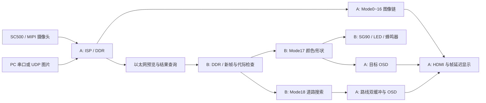

# 工程结构与阅读说明

本说明依据两份当前 TD 工程的文件表、顶层连接、算法模式控制、视频链路、远程识别引擎、道路模块、外设控制及约束整理，不把历史交接记录作为当前入口。

## 数据流

## A 板阅读顺序

`1080p+720p_PhaseB2_dev/user_source/hdl_source/`：

1. `design_top_wrapper.v`：摄像头/DDR/显示/网络/控制接线；`MAX_MODE(18)` 与 `ROAD_PLANNING(1)` 为当前功能入口。
2. `algorithm_mode_control.v`、`algorithm_control_cdc.v`、`algorithm_ctrl_commit.v`：按键和远端模式请求、跨时钟传递、帧边界生效。
3. `video_in.v`、`video_out.v`、`isp/`：视频输入输出及 Bayer/白平衡等前端处理。
4. `video_algorithm_wrapper.v`、`pixel_chain_v1.v`：模式分发、像素/同步信号延迟对齐、Mode0～16 算法、Mode17/18 叠加。
5. `ethernet/ethernet_image_bridge.v`、`remote_vision_client.v`：预览传送、四槽结果查询、代际和超时处理。
6. `road/road_route_writer.v`、`road_route_memory.v`、`road_frame_mailbox.v`、`road_route_osd.v`：路线解码、非活动缓冲区写入、帧边界切换、显示状态。
7. `mipi_frame_timing.v`、`frame_latency.v`、`motion_region_overlay_v1.v`：帧时间、延迟显示及运动区域叠加。

## B 板阅读顺序

`HX1P35A_Cascade_B_clean/user_source/hdl_source/`：

1. `design_top_wrapper.v` 与 `ethernet/`：网络接收、DDR 图像发布、结果应答、外设连接。
2. `remote_vision_engine.v`：Mode17 与 Mode18 的入口和传输格式复用。
3. `mode17_vision_engine.v`：只分析完整且新的 A 板 1280×720 预览图，控制代际变化时清除旧结果。
4. `vision/vision_pipeline.v` 与子模块：颜色分割、二值滤波、游程/连通域、形状特征、目标融合/跟踪、最多四目标的原子结果发布。参数和阈值保持源码原值。
5. `road/road_planner.v`、`road_ram.v`：将预览统计为 80×45 网格，以 RAM 和串行状态机执行道路/标记识别及四邻域路径搜索，结果编码受最多26段游程约束。
6. `mode17_peripheral_control.v`、`mode17_triangle_sorter.v`：Mode17 有效目标结果驱动灯、蜂鸣器和舵机；生产诊断参数 `P_SERVO_USB_DIAG=0`。

## 时钟、约束和 IP

- 两板系统输入时钟约束为50 MHz；逻辑、视频像素、MIPI 和 RGMII 处于多个时钟域，以各自 `.sdc` 为准。
- A 的 `user_source/constraints_source/macro_layout.adc` 包含当前110个宏位置约束；没有把它作为无用生成文件删除。
- `user_source/ip_source/` 与 DDR、MIPI、HDMI 等目录包含厂商封装、加密 HDL、XML、参数隐藏文件、头文件、时序表和初始化数据，整体保留。
- 文件名中的 `_v1`、`_v2`、`beta`、`enc` 不能单凭名字判断为历史版本。当前 `user_source` 内这些文件均保留，包括未直接注册但属于当前 IP/模块树的文件。
- 加密区无法按明文审阅，本次只核对文件、外部接口与依赖，不声称审计了加密实现。

## 外设引脚（以 B 的 pin.adc 为准）

| 功能 | FPGA 引脚 |
|---|---|
| LED 四路 | E12、E16、E17、F13 |
| 蜂鸣器，低有效 | C12 |
| SG90 PWM 信号，J2.7/GPIOB6 | F14 |
| 系统时钟 | C4 |
| UART RX / TX | J1 / H1 |

舵机模块源码要求独立供电，F14 为3.3 V控制信号。实际行程和输入兼容性沿用源码的待实测边界，未以软件打包替代校准。
